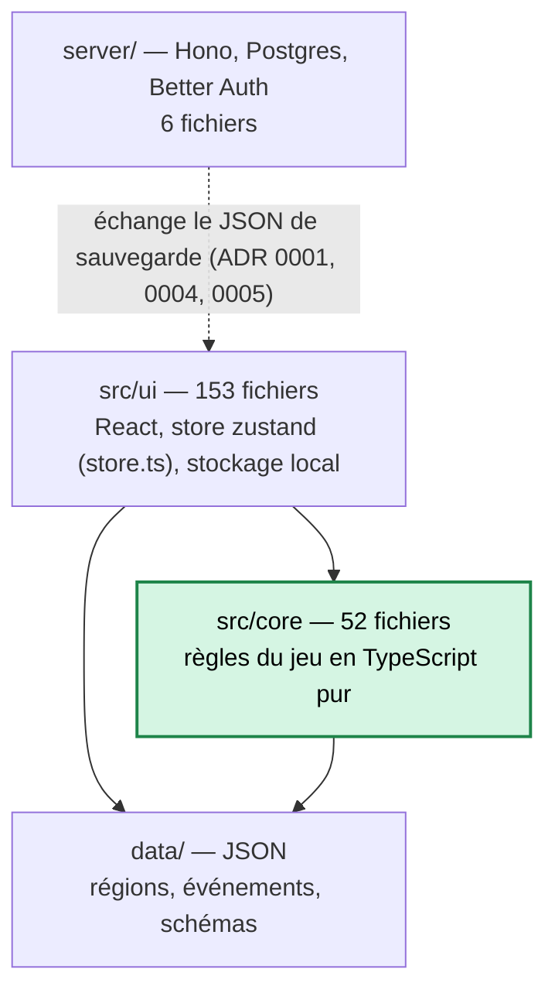

# ADR 0006 — Architecture actuelle de PokiClicker v2 (état au 19/11/2026)

**Statut : accepté, écrit après coup.** Cet ADR décrit une architecture déjà en place depuis la phase 1 (`docs/plan.md`, `CLAUDE.md`). Il ne la change pas : il sert d'état des lieux à l'atelier 6 du cours SOLID Architecture, avant le choix de migration (ADR 0007). Il complète les ADR 0001 (sauvegarde), 0002 (zones), 0004 (synchronisation) et 0005 (serveur).

## Contexte et problème
- Un clicker Pokémon pour Nicolas et quelques amis, sur téléphone et PC, avec compte en ligne et plusieurs régions à venir (huit sont déjà listées dans `data/monde.json`, verrouillées).
- Une personne et des agents de code développent le projet. Les règles de jeu (formules de la V1) doivent rester testables sans navigateur, et le contenu (zones, Pokémon, événements) doit s'ajouter sans toucher au code.

## Critères de décision
1. Tester une règle de jeu sans navigateur ni base, en millisecondes.
2. Ajouter du contenu (une région, un événement) en écrivant des données, pas du code.
3. Un seul code pour téléphone et PC.
4. Rester maintenable par une personne : peu de pièces, pas d'outillage lourd.

## Options envisagées
Comparées après coup sur ces critères. Seule la B a été réellement choisie.

- **A. Tout dans React** : état et règles dans les composants et les hooks.
- **B. Cœur pur + interface + données JSON** (statu quo).
- **C. Couches classiques avec la base de données au fond** : domaine, application, infrastructure, avec l'ORM sous le domaine.

## Décision
Nous retenons l'option B, parce que c'est la seule qui répond aux critères 1 et 2 sans outillage lourd.

Le serveur n'importe rien de `src/` : il ne partage avec le jeu que le format de sauvegarde.

### Ce qui est en place
- **`src/core`** : 52 fichiers de règles (combat, capture, évolution, boutique, sauvegarde, monde...). ESLint interdit dans ce dossier `react`, `react-dom`, `zustand`, `window`, `document`, `localStorage`, `fetch`... (`eslint.config.js`, bloc `src/core/**`). Vérifié le 19/11 : aucun import de React, de zustand ni de `src/ui` dans le cœur.
- **Des ports déjà présents, sans le nom** : `Horloge` (`core/clock.ts`, avec une version système et une version simulée pour les tests) et `Stockage` (`core/sauvegarde.ts`, avec `creerStockageMemoire` dans le cœur et `creerStockageLocal` dans `ui/stockage-local.ts`). Le gestionnaire de sauvegarde reçoit les deux : c'est de l'injection par paramètres.
- **`src/ui`** : 153 fichiers. 79 importent `core`. Un seul store zustand, `ui/store.ts` (1345 lignes, 37 imports de 34 modules du cœur), relie les règles à l'écran.
- **`data/`** : le contenu en JSON, validé au chargement (`chargerMonde`, schémas). 28 fichiers du cœur et 16 de l'interface importent ces JSON directement.
- **Depuis l'atelier 4** : la région Kanto est une dépendance (`Region`, `chargerRegion`, `useRegion`) pour la seule carte des zones.

### Écarts constatés avec ce qu'on veut
- **`store.ts` fait tout** : 1345 lignes, il décide du déroulé du jeu et sert de composition de fait. Il connaît 34 modules du cœur, donc c'est un point de changement unique pour presque tout.
- **Le cœur connaît Kanto par son nom** : `core/regions.ts` importe les JSON de Kanto et exporte `kanto`. 61 fichiers l'importent (14 du jeu, 47 de tests, relevé du 19/11). Ajouter Johto oblige à tous les retoucher.
- **Le cœur lit les JSON directement** (28 fichiers) : le contenu est un détail, mais le cœur en dépend en dur.
- **Pas de contrôle automatique des couches dans l'autre sens** : rien n'empêche le cœur d'importer `src/ui` (aucun cas aujourd'hui). Seules les interdictions de bibliothèques sont vérifiées.
- **Pas de découpage en cas d'usage** : les règles sont des fonctions utilitaires, orchestrées par le store. Pas de couche « application ».

## Conséquences
- Positif :
  - Les règles se testent sans navigateur : 208 fichiers de tests dans `src/`, plus 71 dans `tests/` et 63 en bout en bout.
  - Du contenu se corrige ou s'ajoute en JSON, avec un message d'erreur clair si le fichier est mal formé.
  - Le serveur reste séparé, et le jeu fonctionne avec un stockage en mémoire ou local.
- Négatif :
  - Le store est devenu un point central de 1345 lignes, difficile à relire et à tester seul.
  - Ajouter une région coûte aujourd'hui une retouche de dizaines de fichiers.
  - La règle « le cœur ne dépend pas de l'interface » repose sur ESLint pour les bibliothèques seulement, pas pour les dossiers.

## Avantages et inconvénients des options
| | A. Tout dans React | B. Cœur pur (actuel) | C. Couches + base au fond |
|---|---|---|---|
| Règles testables sans navigateur | non | oui | oui |
| Contenu ajouté sans code | non | oui, partiellement | non |
| Un code pour téléphone et PC | oui | oui | oui |
| Nombre de pièces à tenir | peu | moyen | beaucoup (ORM, couches) |
| Domaine indépendant de la base | non applicable | oui | non (le domaine importe l'infrastructure, cours diapo 53) |

## À revoir si
- Une deuxième région est ajoutée avant que `regions.ts` ait disparu.
- `store.ts` dépasse 2000 lignes, ou une règle y est copiée une deuxième fois.
- Un deuxième client (une application native, un bot) doit réutiliser les règles : il faudra alors des cas d'usage explicites.
