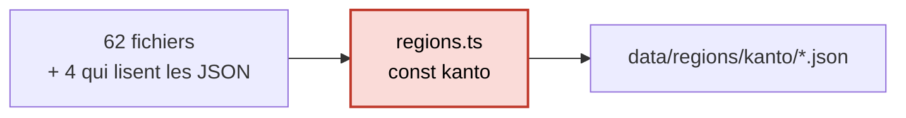
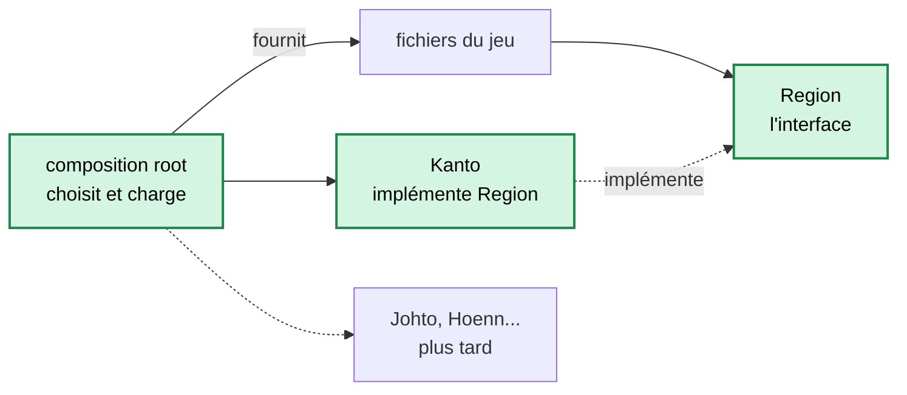

# Les régions comme dépendance

Atelier 4 du cours SOLID Architecture (injection de dépendances), branche `atelier-4/di`. Rien n'est modifié dans le code pour l'instant : ce document explique le choix.

## La dépendance choisie

Une région du jeu : ses zones, ses scènes et les positions de sa carte. Aujourd'hui il n'y a que Kanto (`data/regions/kanto/`), mais `data/monde.json` liste déjà huit régions verrouillées, de Johto à Paldea.

Ce n'est pas utile à PokiClicker tout de suite. C'est la suite du cours, et la conversion complète du projet viendra avant Johto.

## Pourquoi

- **Elle a une vraie règle.** `chargerMonde` (`src/core/monde.ts`) contrôle la région quand on la charge : fichier en version 1, aucun identifiant de zone en double, zone de départ et zone du premier combat qui existent, aucune zone sans sortie, chaque lien qui mène vers une zone qui existe. Une région mal écrite fait échouer le chargement avec un message clair.
- **On peut la brancher ou la débrancher.** Chaque région est un dossier de données à part, et le jeu sait déjà qu'il en aura huit de plus.
- **Elle allège le chargement.** Mon prof m'a conseillé de ne charger que la région où le joueur se trouve, au lieu de traîner toutes les autres sans les utiliser.

## Le pb aujourd'hui

`src/core/regions.ts` (lignes 1 à 6) importe les données de Kanto en dur et exporte une constante `kanto`. 62 fichiers importent ce module. Quatre autres fichiers lisent les données de Kanto sans passer par lui : `guide.ts`, `scenes.ts`, `CarteKanto.tsx` et `journal-zones.ts`.

Deux conséquences :
- Quand il y aura plusieurs régions, toutes seront dans le téléchargement du jeu dès le départ.
- Ajouter Johto obligera à retoucher chacun de ces fichiers, parce que tous connaissent Kanto par son nom.

C'est ce que le principe d'inversion des dépendances (DIP) veut éviter : le code du jeu dépend d'un détail (Kanto) au lieu d'une abstraction (une région).

Avant : tout le code connaît Kanto.

Après : le code reçoit une région. Un seul endroit décide laquelle charger.

## Cours

- **DIP** : le jeu dépend de l'interface `Region`, pas de Kanto.
- **DI** : une région est reçue de l'extérieur, au lieu d'être importée par chaque fichier qui s'en sert.
- **Composition root** : un seul fichier, près du point d'entrée, choisit la région et la charge. C'est le seul qui connaît Kanto. On fait de la « Pure DI », sans bibliothèque de conteneur.

## Fait

Un morceau seulement :
- `src/core/region.ts` : le type `Region` (identifiant, monde, scènes, positions de la carte) et le type `ChargeurRegion`.
- `src/core/region-kanto.ts` : le chargeur de Kanto, qui lit les trois fichiers JSON avec des `import()` dynamiques.
- `src/ui/composition-root.ts` : le registre des régions et la fonction `chargerRegion(id)`, qui refuse une région inconnue.
- `src/ui/ContexteRegion.ts` : un contexte React et le hook `useRegion()`. C'est la manière du cours de passer un service global à React.
- `src/ui/main.tsx` : charge la région avant d'afficher le jeu, puis la fournit à toute l'application.
- `src/ui/CarteKanto.tsx` : la carte des zones de Kanto reçoit la région par `useRegion()` au lieu d'importer les positions des repères et la constante `kanto`. Le dessin de la carte (`carte-kanto.webp`) y est encore écrit en dur : il faudra le lire dans le champ `carte` de la région et renommer le composant `CarteRegion` avant Johto.

Les tests de l'interface utilisent une région Kanto fournie par un fichier d'amorçage (`src/ui/region-tests.ts`), pour ne pas réécrire une vingtaine de fichiers de tests.

Le reste reste pour plus tard : `regions.ts` et ses 62 importeurs, `guide.ts`, `scenes.ts` (avec `PageIntro` et `ScenesBourgPalette`) et `journal-zones.ts`.

Une preuve que la conversion n'est pas finie : le build avertit que `zones.json` et `scenes.json` sont chargés dynamiquement par `region-kanto.ts` mais aussi importés en dur ailleurs, donc ils restent dans le gros fichier du jeu. Seules les positions de la carte (`carte-positions.json`, moins d'1 ko) sont sorties dans un fichier à part. Le gain apparaîtra quand les importeurs en dur auront disparu.

## Limites

- Le gain de performance est nul tant qu'il n'y a que Kanto. Good avec les prochaines régions.
- Charger une région à la demande rend le démarrage asynchrone : aujourd'hui `kanto` est lue tout de suite, demain il faudra attendre la région avant d'afficher le jeu.
- La sauvegarde devra retenir la région du joueur.
- La conversion des 62 fichiers va au backlog, avant Johto.
