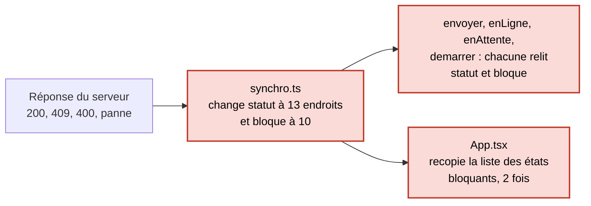
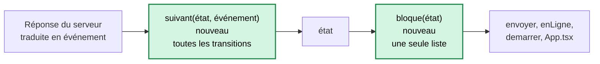
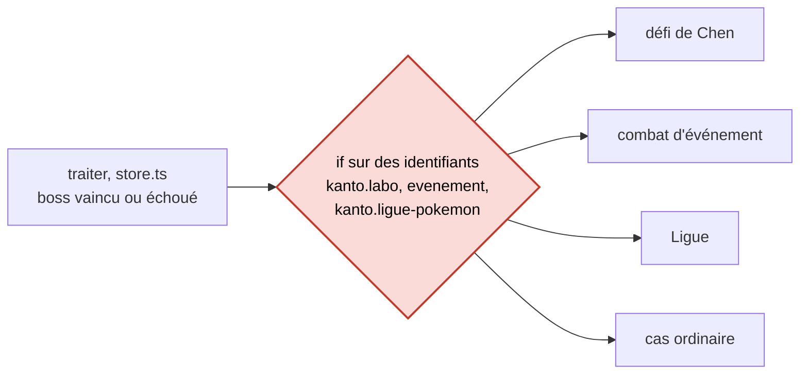
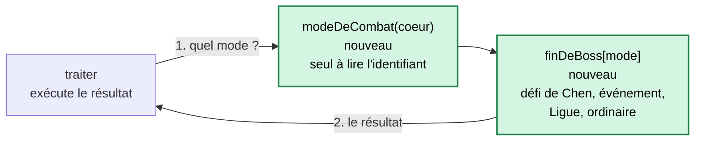

# Deux patterns de comportement pour PokiClicker v2

Atelier 3 du cours SOLID Architecture, branche `atelier-3/patterns`. Je pars de `docs/anti-patterns.md` et je cherche deux endroits où un pattern de comportement aiderait vraiment. Rien n'est modifié dans le code. Les noms de fonctions et de fichiers sont des propositions, les tests sont à écrire et les durées sont des estimations.

## 1. State sur la synchro

**Le symptôme.** `src/ui/synchro.ts` envoie la sauvegarde au serveur. Ce qu'elle a le droit de faire dépend de son état, qui vaut `inactif`, `ok`, `hors-ligne`, `refuse`, `ailleurs` ou `divergence` (ligne 6). Par exemple, en `ailleurs` plus rien ne part, et en `divergence` le retour du réseau lance une résolution au lieu d'un envoi (ligne 314). Mais cette règle n'est écrite nulle part. Elle est éparpillée :

- l'état est gardé dans deux variables, `statut` (ligne 71) et un booléen `bloque` (ligne 73) ;
- `statut` est modifié à 13 endroits (lignes 143, 154, 178, 182, 197, 219, 281, 286, 292, 298, 300, 301, 302) et `bloque` à 10 ;
- les deux doivent rester d'accord à la main. Chaque fois que `bloque` passe à vrai, `statut` vaut `refuse`, `ailleurs` ou `divergence`. Mais à la ligne 472, `demarrer` remet `bloque` à faux sans toucher `statut`, qui peut encore valoir `refuse`. Je n'ai pas vérifié si c'est voulu ;
- les décisions qui lisent l'état sont aux lignes 188, 195, 222, 236, 314, 457, 472 et 479 ;
- hors du fichier, `App.tsx` recopie la liste `['hors-ligne', 'refuse', 'divergence']` aux lignes 167 et 182, et `estProbleme` (`synchronisations.ts:11`) en donne une troisième, qui inclut `ailleurs`.

Le dernier état ajouté, `ailleurs`, date du 07/11 (commit `46931da`), trois jours après les tickets D et E de la synchro. `synchro.ts` figurait dans le classement de l'atelier 1 (score 3 654, complexité 406) mais je ne l'avais pas ouvert. Je l'ai lu pour cet atelier.

**Le pattern : State.** Le cours le résume ainsi : le comportement dépend de l'état, et les transitions sont à un seul endroit (diapo 46). En TypeScript je n'ai pas besoin de classes. Un type pour les événements et une fonction pure suffisent :

```text
suivant(etat, evenement) -> etat      toutes les transitions, dans un seul fichier
bloque(etat)                          vrai pour refuse, ailleurs, divergence
```

La variable `bloque` disparaît : elle se déduit de l'état, donc elle ne peut plus s'en écarter.

**Pourquoi pas un autre.**
- Strategy (diapo 43) : on choisit un algorithme et on le garde. Ici c'est le résultat d'un envoi qui change ce que la synchro peut faire ensuite.
- Observer (diapo 44) : il annonce un fait à ceux qui écoutent, et la synchro le fait déjà avec `quandChange` et `quandAilleurs`. Il ne dit pas ce qui est permis dans quel état.
- Chain of Responsibility (diapo 47) : seules deux gardes se répètent (`if (arrete || bloque)`, lignes 236 et 479). Ce n'est pas le symptôme « le même contrôle avant chaque traitement » de la diapo 49. Le vrai problème est l'état et ses changements.
- Command (diapo 45) : il n'y a rien à annuler ni à rejouer.
- Aucun pattern : la solution la moins chère est une seule constante `ETATS_BLOQUANTS` et une fonction `bloque()`. Elle supprime les listes recopiées de `App.tsx`, mais elle laisse les 13 changements d'état dispersés. C'est ce que je ferais si je n'avais qu'une heure.

**Avant / après.**

Avant : l'état est changé et relu partout.



Après : un seul endroit décide du changement d'état, et une seule liste dit ce qui bloque.



```text
AVANT  réponse 409 avec le code 'ailleurs' :
         statut = 'ailleurs'; bloque = true; quandAilleurs(); quandChange()

APRÈS  etat = suivant(etat, 'serveur-ailleurs')       // 'ailleurs'
         puis quandAilleurs(); quandChange()           // les effets restent dans synchro.ts
```

**Le test qui prouve le comportement.** Aujourd'hui, pour vérifier qu'un refus du serveur bloque les envois suivants, le test de `synchro.test.ts:375` monte la synchro, fabrique une fausse réponse `new Response(..., { status: 400 })`, envoie deux fois et compte les requêtes `PUT`. Après, le test ne touche plus au réseau :

```text
it.each([
  ['inactif', 'envoi-accepte',   'ok'],
  ['ok',      'reseau-coupe',    'hors-ligne'],
  ['ok',      'serveur-ailleurs','ailleurs'],
  ['ok',      'conflit',         'divergence'],
  ['ok',      'client-trop-ancien', 'refuse'],
  ['divergence', 'resolu',       'inactif'],
])  suivant(etat, evenement) vaut l'état attendu

bloque(etat) est vrai pour refuse, ailleurs, divergence, faux pour les trois autres
```

Les 36 tests de `synchro.test.ts` et les 4 de `store-synchro.test.ts` restent le filet de sécurité : ils doivent passer sans changement.

**Ce que ça coûte.**
- Fichiers en plus : `etat-synchro.ts` (le type, `suivant`, `bloque`) et son test. `synchro.ts` y perd la variable `bloque`, et `App.tsx` ses deux listes.
- Un niveau d'indirection : pour savoir ce qui se passe après un 409, il faut lire le code qui reçoit la réponse puis la table de transitions.
- À connaître : le State, et la liste des événements qui font changer l'état.
- Le point difficile : les effets qui accompagnent un changement d'état (`quandAilleurs`, `quandMiseAJourRequise`, `quandChange`, lignes 286, 292 et 298) restent dans `synchro.ts`. `suivant` décide, `synchro.ts` exécute.
- Lien avec l'atelier 2 : les résultats que renverrait l'Adapter (`accepte`, `ailleurs`, `divergence`, `hors-ligne`) deviennent les événements du State. Les deux se complètent, mais le State peut se faire sans l'Adapter.
- Estimation : 1 à 2 jours.

## 2. Strategy sur la fin de boss

**Le symptôme.** Dans `traiter` (`src/ui/store.ts:321-471`), quand un boss est vaincu (lignes 384-422) ou échoue (423-438), la règle dépend du type de combat. Le code choisit avec des `if` sur des identifiants écrits à la main :

| Type de combat | Boss vaincu | Boss échoué |
|---|---|---|
| Défi de Chen, `'kanto.labo'` (lignes 386 et 425) | `victoireDefi`, le combat s'arrête, `return` | `echecDefi`, changement de zone, `return` |
| Combat d'événement, variable `combatEvenement` (lignes 393 et 434) | on termine l'événement et on sauvegarde, sans badge ni Panthéon | message « Temps écoulé ! », le dresseur reprend son premier Pokémon |
| Ligue, `'kanto.ligue-pokemon'` (ligne 398, `estZoneDeLigue` ligne 437) | victoire enregistrée, Panthéon ouvert, puis la suite ordinaire | message de défaite de la Ligue, sauvegarde |
| Cas ordinaire | badge, zone débloquée, sauvegarde | « Temps écoulé ! » |

Ces 55 lignes représentent plus du tiers des 151 lignes de `traiter`. Les trois variantes sont arrivées l'une après l'autre : la Ligue le 25/10 (`b985e9a`), les combats de scènes le 26/10 (`5c59171`) et le défi de Chen le 26/10 (`9dcfb38`). Chacune a ajouté sa branche dans la même fonction.

Le type de zone ne permet pas de les distinguer. Le labo (`core/defi-chen.ts:55`) et les combats d'événement (`core/combat-evenement.ts:16`) ont `type: 'ligue'`, comme la vraie Ligue. `estZoneDeLigue` est donc vrai pour les trois, et c'est l'identifiant écrit en chaîne qui fait le tri. C'est le même défaut que AP-4, et le même fichier que AP-1 et AP-3.

**Le pattern : Strategy.** Le cours parle d'algorithmes interchangeables, choisis à l'exécution, et note qu'en TypeScript une stratégie sans état est souvent une simple fonction (diapo 43). Je ferais un petit tableau :

```text
finDeBoss = { defiChen, combatEvenement, ligue, ordinaire }
chaque entrée a deux fonctions : vaincu(region, evenement) et echoue(region, evenement)
```

Une seule fonction, `modeDeCombat(coeur)`, lirait l'identifiant. `traiter` demanderait le mode, appellerait la stratégie et appliquerait ce qu'elle renvoie.

**Pourquoi pas un autre.**
- Observer (diapo 44) : il convient quand plusieurs réactions indépendantes suivent un fait. Ici, la victoire du labo doit empêcher les autres réactions (pas de badge), et l'ordre compte. Le store a déjà un Observer pour la partie indépendante : les sons, les gains et les dégâts (`store.ts:224`, `227` et `1239-1252`).
- Chain of Responsibility (diapo 47) : c'est le plus proche, le code actuel en est même une, écrite avec des `if` et des `return`. Je ne le retiens pas parce que le mode est connu dès le début du combat. On n'a pas besoin de demander à chaque maillon « est-ce pour toi ? », et un tableau se lit mieux. La chaîne deviendrait utile si plusieurs modes se cumulaient.
- State (diapo 46) : le mode ne change pas pendant un combat, il est fixé par la zone au départ.
- Template Method (diapo 48) : la Ligue fait une étape à elle puis la suite ordinaire (badge, zone débloquée). C'est bien « un algorithme fixe avec une étape qui varie ». Le cours recommande la composition à l'héritage, donc on passe l'étape en paramètre, ce qui est une Strategy.
- Command (diapo 45) : on n'a rien à annuler ni à rejouer.
- Aucun pattern : la diapo 49 dit qu'un petit `if` n'a pas besoin de Strategy. Ici ce n'est pas un petit `if` : 55 lignes, six tests sur le type de combat et trois ajouts en deux jours. Mais je ne sais pas combien de modes viendront. S'il n'y en a plus, le `if` actuel marche, et ma raison principale devient le test.

**Avant / après.**

Avant : `traiter` contient tous les cas.



Après : un seul endroit choisit le mode, chaque mode a sa fonction, et `traiter` exécute le résultat.



```text
AVANT  boss-vaincu : si zone = 'kanto.labo' alors victoireDefi, coeur = null, return
                     sinon si combatEvenement alors terminer, continue
                     sinon si Ligue alors victoire enregistrée, Panthéon, puis badge, déblocage...

APRÈS  mode = modeDeCombat(coeur)
       resultat = finDeBoss[mode].vaincu(region, evenement)
       puis traiter applique resultat.region, sauvegarde, ouvre le Panthéon si le résultat le dit
```

**Le test qui prouve le comportement.** Aujourd'hui, vérifier « le défi de Chen vaincu ne donne pas de badge » demande de monter tout le store et de jouer un combat (`store-fin.test.ts`). Après, le test appelle directement la stratégie :

```text
finDeBoss.defiChen.vaincu(region, evenement)    renvoie la région de victoireDefi, aucun badge
finDeBoss.ligue.vaincu(region, evenement)       renvoie ouvrirPantheon à vrai, et le badge de la suite ordinaire
finDeBoss.combatEvenement.echoue(region, ...)   renvoie le message de reprise, sans changer de zone
```

Le filet de sécurité existe déjà : `store-fin.test.ts:61` (échec du labo), `store-ligue.test.ts:80` et `:118` (victoires de la Ligue), `store-evenements.test.ts:78` et `:213` (combats d'événement).

**Ce que ça coûte.**
- Fichiers en plus : `fin-de-boss.ts` avec les quatre stratégies, et son test. `traiter` perd environ 40 lignes (estimation).
- Un niveau d'indirection : pour suivre une victoire de boss, il faut lire `traiter`, le choix du mode, puis la stratégie.
- À connaître : la Strategy, et l'idée que la stratégie décrit ce qu'il faut faire sans le faire.
- Le point difficile : les branches actuelles font des `return` hors de `traiter` (lignes 391 et 432), mettent `coeur = null` et appellent `executer` et `signaler` (388-391). Une stratégie ne peut pas faire ça : elle renvoie un résultat et `traiter` l'exécute. Il faut décider ce que contient ce résultat.
- Lien avec l'atelier 2 : la Façade « ServiceCombat » touche aux mêmes lignes de `traiter`. Les deux changements ne se font pas en parallèle ; les stratégies pourraient vivre dans ce service.
- Estimation : 2 à 3 jours.

## Où je ne mettrais rien

`trierPc` (`src/core/pc.ts:22-29`) a un `switch` de six cas pour les tris du PC (`dps`, `numero`, `nom`, `niveau`, `favori`, `shiny`). Ce n'est pas un symptôme de Strategy : chaque cas tient en une ligne, il n'y a pas d'état, et un nouveau tri ajoute une ligne dans un seul endroit. C'est le « petit `if` » de la diapo 49 : un pattern ajouterait des fichiers sans rien gagner.
