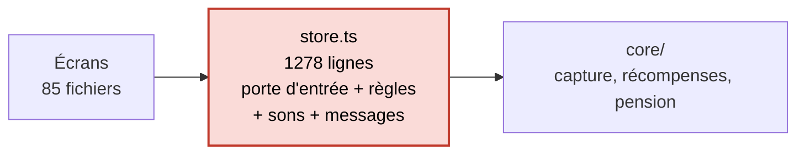
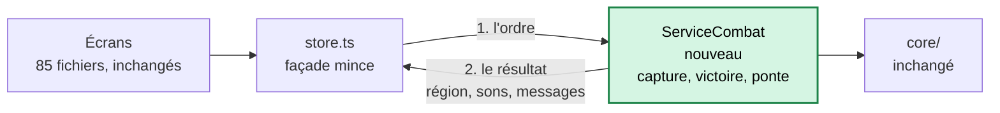
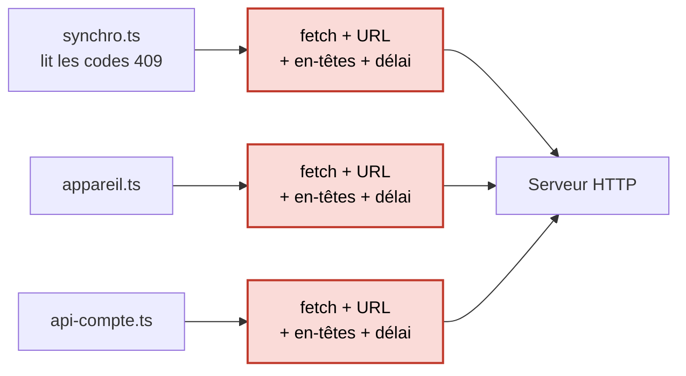
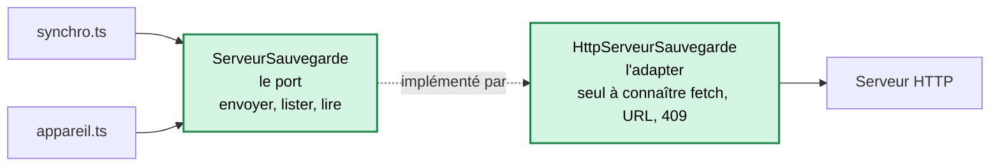

# Deux patterns pour PokiClicker v2

Atelier 2 du cours SOLID Architecture, branche `atelier-2/patterns`. Je pars de `docs/anti-patterns.md` et je choisis deux endroits où un pattern aiderait vraiment. Rien n'est modifié dans le code. Les noms de classes sont des propositions et les durées sont des estimations.

## 1. Façade sur le store

**Le problème.** `src/ui/store.ts` fait 1278 lignes. Les écrans ne parlent qu'à lui, c'est bien. Mais il contient aussi le déroulé du jeu : dans `traiter`, il applique lui-même la capture, la victoire et la ponte, joue les sons et prépare les messages. La porte d'entrée et les règles sont mélangées dans le même fichier (AP-2, AP-3 et AP-7 de l'atelier 1).

**Le pattern : Façade.** Le store reste la porte d'entrée, avec les mêmes noms pour les écrans. Mais il passe l'ordre à un service qui fait le travail, et il se contente d'exécuter le résultat. Le cours dit qu'une façade doit rester mince et sans règle métier : celle-ci ne l'est plus.

**Pourquoi pas un autre.**
- Découper le store en slices zustand : le store garde son état dans des variables internes, pas dans zustand, et il faudrait modifier les 85 fichiers qui l'importent.
- Mediator : il sert quand des objets se parlent entre eux. Ici tout passe par un seul chef d'orchestre, donc on n'enlèverait rien à `store.ts`.

**Avant / après.**

Avant : un seul gros fichier fait tout.



Après : le store reste la porte d'entrée, un service porte les règles.



```text
AVANT  traiter() : applique la capture, la victoire, la ponte,
                   joue les sons, écrit les messages, sauvegarde

APRÈS  traiter() : resultat = serviceCombat.traiter(region, evenements)
                   puis joue les sons et affiche les messages du résultat
```

Le service décide mais ne joue rien : il renvoie ce qu'il faut faire, et le store le fait.

**Ce que ça coûte.**
- Fichiers en plus : un service et son test. `store.ts` perd environ 150 lignes.
- Un appel de plus entre l'écran et la règle : il faut lire deux fichiers pour suivre un combat.
- À connaître : la Façade, et la séparation entre décider et exécuter.
- Le point difficile : `traiter` modifie une quarantaine de variables du store, il faut choisir ce que le service reçoit et rend.
- Le filet de sécurité existe : 23 fichiers de tests couvrent déjà le store.
- Estimation : 2 à 4 jours.

## 2. Adapter sur le serveur

**Le problème.** Le même appel au serveur est recopié à quatre endroits (`synchro.ts` deux fois, `appareil.ts`, `api-compte.ts`) : URL, en-tête, délai de 8 s. Et `synchro.ts` lit lui-même les réponses HTTP : il connaît le statut 409 et le code `'ailleurs'`. Dans ses tests, `fetch` est cité 105 fois, parce qu'il faut fabriquer de fausses réponses HTTP.

**Le pattern : Adapter.** La synchro parle à un port écrit dans le vocabulaire du jeu (envoyer la partie, lister les parties). Un adapter traduit ça en appels HTTP. Le cours le décrit ainsi : le port parle métier, l'adapter parle fournisseur.

**Pourquoi pas un autre.**
- Une simple fonction partagée pour les quatre appels : c'est la solution la moins chère et elle supprime la copie, mais la synchro continuerait à lire des codes 409.
- Decorator ou Proxy : ils gardent la même interface et ne traduisent rien. Un Decorator servirait plus tard pour ajouter un retry.

**Avant / après.**

Avant : chaque fichier parle HTTP lui-même, et le même appel est recopié.



Après : un seul endroit traduit vers HTTP, les autres parlent le langage du jeu.



```text
AVANT  synchro : fetch(...), puis si statut 409 et code 'ailleurs' → statut « ailleurs »

APRÈS  synchro : resultat = serveur.envoyer(changements)
         resultat vaut 'accepte', 'ailleurs', 'divergence' ou 'hors-ligne'
```

**Ce que ça coûte.**
- Fichiers en plus : le port, l'adapter HTTP et un faux serveur pour les tests. Trois fichiers à modifier.
- Un niveau de plus entre la synchro et le réseau, mais les quatre copies disparaissent.
- À connaître : port et adapter, et l'injection du port dans la synchro.
- Le point difficile : réécrire une bonne partie des 820 lignes de `synchro.test.ts` avec le faux serveur. C'est aussi le gain, parce qu'un test dira « le serveur répond ailleurs » au lieu de fabriquer une réponse 409.
- Estimation : 2 à 3 jours.

L'Adapter n'est pas dans `anti-patterns.md` : je l'ai trouvé en cherchant les appels vers l'extérieur.
[text](<../../../../Downloads/5. SOLID Architecture.pdf>)